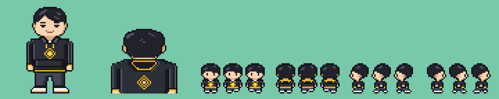

# CZ player sprites

An original player character for the CZ / Binance game: short black side-parted hair,
a black hoodie with a gold Binance-style diamond, gold drawstrings, a gold-lined hood,
gold cuffs and hem, dark slacks and white sneakers with gold soles.
Everything is drawn by hand as pixel art in `cz_art.py`. Each sprite uses at most 16
colors (including transparency), so it fits a GBA/FRLG 16-color palette slot.



| File | Size | What |
| --- | --- | --- |
| `cz_battle_front.png` | 64x64 | Battle / trainer front sprite |
| `cz_battle_back.png` | 64x64 | Battle back sprite |
| `cz_overworld_sheet.png` | 48x128 | Walk cycle: rows down, up, left, right; columns stand, step L, step R (16x32 frames) |
| `overworld/cz_walk_<dir>_<n>.png` | 16x32 | The same frames as separate files |
| `preview.png`, `preview_walk.gif` | – | Previews only |

All PNGs have transparent backgrounds. The walk animation plays frames `1, 0, 2, 0`.

## Editing

Change the ASCII art in `cz_art.py`, where each character is one pixel from `PALETTE`,
then rebuild:

```sh
python3 build.py            # needs Pillow
```
